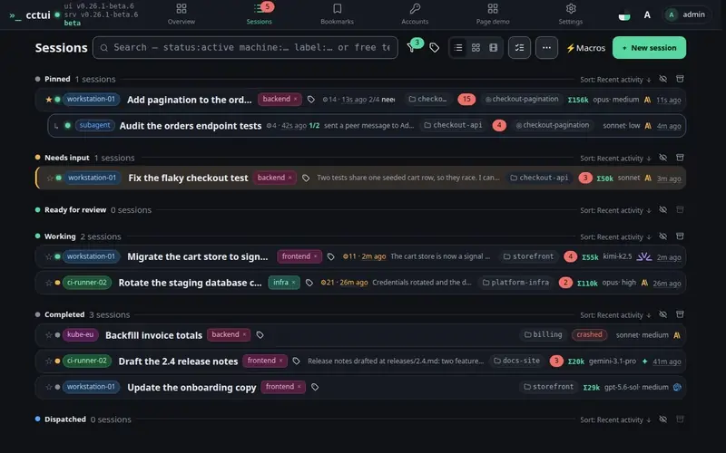
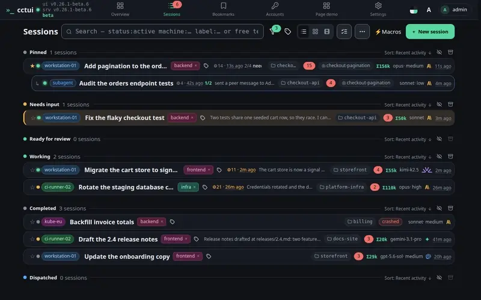
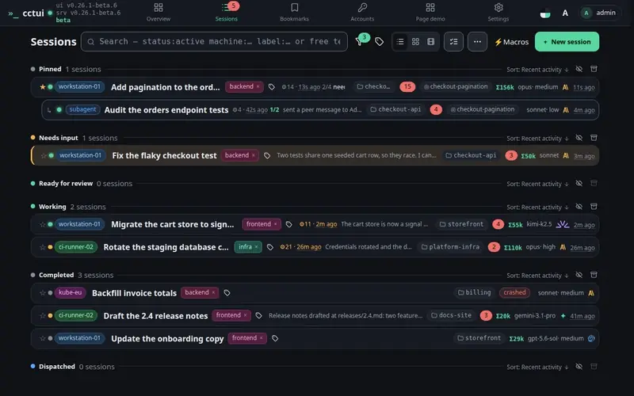
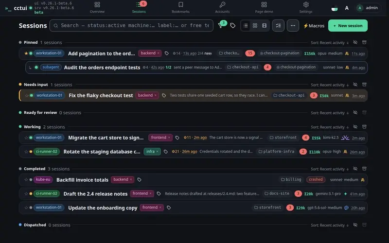
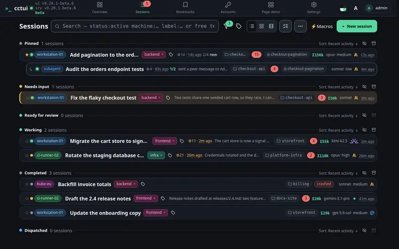
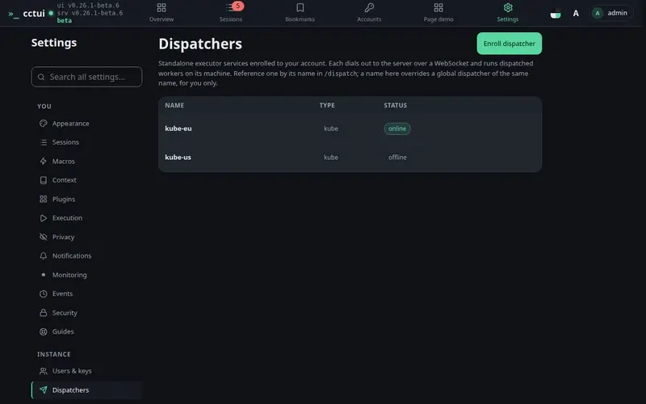
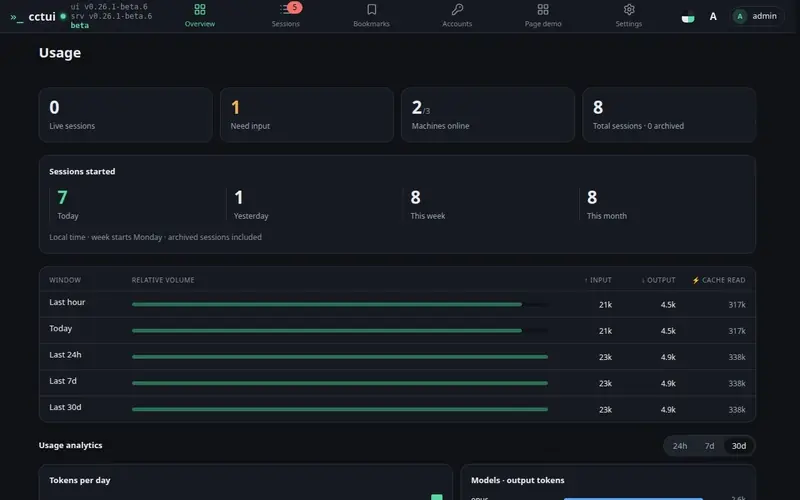
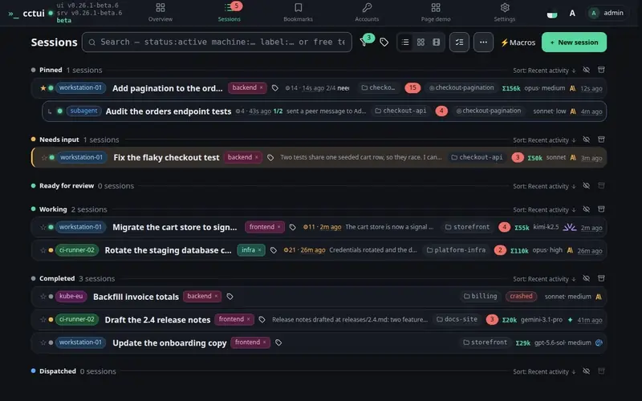
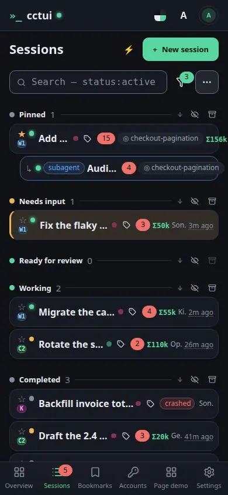
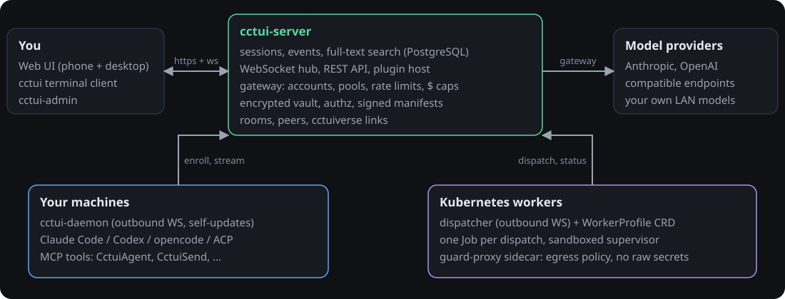

<div align="center">


# cctui

### Every agent. Every machine. One window.

Watch, drive and orchestrate **Claude Code, Codex, opencode and any ACP agent** across all your machines
and throwaway Kubernetes workers, from one self-hosted web UI and a terminal client.

[](https://github.com/DorskFR/cctui/releases)
[](LICENSE)
[](https://dorskfr.github.io/cctui/)

**[Docs](https://dorskfr.github.io/cctui/)** ·
**[Quick start](#quick-start)** ·
**[Features](https://dorskfr.github.io/cctui/features/harnesses/)** ·
**[Architecture](https://dorskfr.github.io/cctui/architecture/)** ·
**[Compare](https://dorskfr.github.io/cctui/comparison/)** ·
**[Releases](https://github.com/DorskFR/cctui/releases)**

<a href="https://dorskfr.github.io/cctui/">
  
</a>

<sub>Recorded against a local demo instance with invented data. Longer clips play on the <a href="https://dorskfr.github.io/cctui/">docs site</a>.</sub>

</div>

## What you get

1. **One window for every agent.** Claude Code, Codex, opencode, Gemini, Qwen and Goose stream into the same transcript view.
2. **Answer from anywhere.** Approve tool calls, fill in question forms and reply mid-turn, from your desk or your phone.
3. **Your whole fleet.** Enroll any machine with one command. Spawn an agent on any of them, or on a throwaway Kubernetes pod.
4. **Agents that spawn agents.** Every session gets MCP tools to run nested subagents on any harness, message its peers and talk in rooms.
5. **Know what it costs.** Many subscription accounts, pools with failover, 5h and weekly windows, per-model usage and dollar caps.
6. **Yours.** MIT, self-hosted, one server and one PostgreSQL. Daemons connect out; nothing listens on your machines.

## A closer look

<table>
<tr>
<td width="50%" valign="top">
<a href="https://dorskfr.github.io/cctui/features/live-sessions/"></a>
<b>Follow every session live</b><br>
Text, thinking and tool calls as they happen. Reply, interrupt or steer from the composer.
</td>
<td width="50%" valign="top">
<a href="https://dorskfr.github.io/cctui/features/permissions/"></a>
<b>Approve from anywhere</b><br>
Permission cards, plan cards and AskUserQuestion forms, answered inline. Per-session policies and auto-approve.
</td>
</tr>
<tr>
<td width="50%" valign="top">
<a href="https://dorskfr.github.io/cctui/features/fleet/"></a>
<b>Spawn on any machine</b><br>
Pick the machine, folder, harness and model. Save it as a profile, park it as a draft, schedule a follow-up.
</td>
<td width="50%" valign="top">
<a href="https://dorskfr.github.io/cctui/features/subagents/"></a>
<b>Agents that spawn agents</b><br>
<code>CctuiAgent</code> runs parallel nested subagents on any harness, with live progress and budgets.
</td>
</tr>
<tr>
<td width="50%" valign="top">
<a href="https://dorskfr.github.io/cctui/features/harnesses/"></a>
<b>One renderer for every harness</b><br>
Claude Code, Codex, opencode and ACP agents normalise to one event shape, so they all look the same.
</td>
<td width="50%" valign="top">
<a href="https://dorskfr.github.io/cctui/features/rooms/"></a>
<b>Sessions talk to each other</b><br>
Peer messages and rooms, across harnesses and machines. Even across cctui servers, with cctuiverse links.
</td>
</tr>
<tr>
<td width="50%" valign="top">
<a href="https://dorskfr.github.io/cctui/features/workers/"></a>
<b>Throwaway Kubernetes workers</b><br>
One pod per task from a <code>WorkerProfile</code>. A guard proxy injects credentials so workers never see raw secrets.
</td>
<td width="50%" valign="top">
<a href="https://dorskfr.github.io/cctui/features/usage/"></a>
<b>Know what the fleet costs</b><br>
Accounts, pools, 5h and weekly windows, per-model spend and hard dollar caps per session.
</td>
</tr>
<tr>
<td width="50%" valign="top">
<a href="https://dorskfr.github.io/cctui/features/search/"></a>
<b>Find any conversation</b><br>
Full-text search over every transcript, with <code>label:</code>, <code>machine:</code> and <code>status:</code> facets, bookmarks and archive.
</td>
<td width="50%" valign="top">
<a href="https://dorskfr.github.io/cctui/features/themes-mobile/"></a>
<b>Built for your phone too</b><br>
A "Needs you" list, drawers instead of panes, and 31 themes. Talk to your agents with live voice.
</td>
</tr>
</table>

<p align="center"><a href="https://dorskfr.github.io/cctui/"><b>All 16 feature areas on the docs site →</b></a></p>

## Quick start

**1. Start the server.** Docker Compose pulls the published images plus PostgreSQL. Linux and macOS.

```sh
git clone https://github.com/DorskFR/cctui && cd cctui
make local/up          # UI on http://localhost:8088, API on :8700, prints the admin token
```

**2. Enroll a machine.** The daemon runs on your host, next to your real `claude` / `codex` / `opencode` binaries.

```sh
curl -fLo cctui-daemon https://github.com/DorskFR/cctui/releases/latest/download/cctui-daemon-linux-amd64
chmod +x cctui-daemon
./cctui-daemon enroll --server-url http://localhost:8700 --token <admin-token> --name "$(hostname)"
./cctui-daemon service install   # systemd user service (launchd on macOS)
```

**3. Drive it.** Open the UI, start an agent on your machine, approve its first tool call from your phone.

`make local/demo` loads an invented demo fleet, so you can look around before enrolling anything.

<details>
<summary><b>More: configuration, Kubernetes workers, local development</b></summary>

- **Configuration.** `make local/up` writes `deploy/local/.env` with a random admin token (`CCTUI_ADMIN_TOKENS`) and
  vault key (`CCTUI_VAULT_KEY`). Ports bind to `127.0.0.1`; set `CCTUI_BIND_ADDR` to expose them. Other targets:
  `make local/pull`, `local/logs`, `local/ps`, `local/down`. See [Configuration](https://dorskfr.github.io/cctui/getting-started/configuration/).
- **Users.** Create user tokens on the UI's Users page or with `cctui-admin`. A machine enrolled with a user's token
  belongs to that user.
- **Upstreams.** A compatible-endpoint account pointing at an internal or plain `http` host is refused unless allowed in
  Settings › Instance or `CCTUI_UPSTREAM_ALLOWED_HOSTS` ([docs/gateway-upstreams.md](docs/gateway-upstreams.md)).
- **Kubernetes workers.** Run a dispatcher in your cluster and describe workers with a `WorkerProfile`:
  [Run on Kubernetes workers](https://dorskfr.github.io/cctui/getting-started/kubernetes-workers/).
- **Local development.** Prerequisites: Rust (nightly for fmt), Docker, PostgreSQL, Node.js and bun.

  ```sh
  make setup          # start postgres, migrate, build
  make run/server     # server on :8700
  make webui/install && make webui/dev
  ```

</details>

## Works with

| Harness | How cctui drives it | Live transcript | Permissions & questions | Spawn | Nested subagents |
| --- | --- | :---: | :---: | :---: | :---: |
| Claude Code | headless, or attached to its daemon | ✅ | ✅ | ✅ | ✅ |
| Codex | app-server | ✅ | ✅ | ✅ | ✅ |
| opencode | server API | ✅ | ✅ | ✅ | ✅ |
| Gemini, Qwen, Goose, any ACP agent | Agent Client Protocol | ✅ | ~ permissions only | ✅ | ~ can be a child, not a parent |

Details per harness: [docs/harness-parity.md](docs/harness-parity.md).

## How it fits together

<p align="center"></p>

- **cctui-server** (Rust, Axum, PostgreSQL): session registry, event store, full-text search, WebSocket hub, REST API, model gateway, encrypted vault.
- **cctui-daemon**: one per machine. Connects out over WebSocket, drives the agents and self-updates from the server.
- **Web UI** (SvelteKit) and **`cctui`** terminal client; **`cctui-admin`** for users, machines and usage.
- **Dispatchers** turn tasks into ephemeral Kubernetes pods behind a guard proxy.

## Where to next

| I want to… | Start here |
| --- | --- |
| Try it in five minutes | [Quick start](https://dorskfr.github.io/cctui/getting-started/quick-start/) |
| Add my laptop and servers | [Enroll a machine](https://dorskfr.github.io/cctui/getting-started/enroll-a-machine/) |
| Run agents on Kubernetes | [Kubernetes workers](https://dorskfr.github.io/cctui/getting-started/kubernetes-workers/) |
| Let my agents spawn and talk to agents | [MCP tools for agents](https://dorskfr.github.io/cctui/reference/mcp-tools/) |
| See how it compares | [Comparison](https://dorskfr.github.io/cctui/comparison/) |
| Browse every screen | [Feature tour](docs/journeys.md) |

> [!NOTE]
> cctui is an early-stage personal project that ships several times a day. Expect breaking changes and rough edges.

## License

[MIT](LICENSE)
